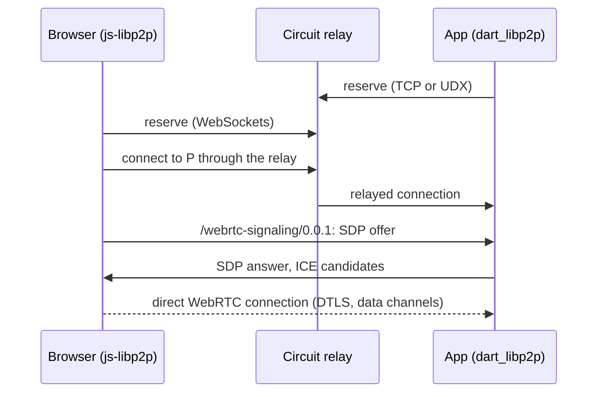

# dart_libp2p_webrtc

dart_libp2p_webrtc is the libp2p **WebRTC transport** for
[dart_libp2p](../../dart-libp2p/doc/index.md). It lets a Dart or Flutter app
and a web app running [js-libp2p](https://github.com/libp2p/js-libp2p) in a
browser connect **directly** to each other. Two Dart apps can use it too.

Browsers can't open raw TCP or UDP connections, so they can't use the
transports dart_libp2p speaks natively. They can use WebRTC, and libp2p
specifies how: the [`/webrtc` transport](https://github.com/libp2p/specs/blob/master/webrtc/webrtc.md),
also called *private-to-private* WebRTC. The two peers find each other
through a circuit relay, exchange SDP over a stream on the relayed
connection, and then talk peer to peer over WebRTC data channels. The relay
only carries the signaling.



Under the hood it uses [libdatachannel](https://github.com/paullouisageneau/libdatachannel),
a C/C++ WebRTC library, through `dart:ffi`. The package's build hook
compiles it from source for Android, iOS, Linux and macOS, so there's no
separate native install.

```sh
dart pub add dart_libp2p_webrtc
```

## What you get

| Feature | Notes |
|---|---|
| libp2p `/webrtc` | Dials and accepts `/p2p-circuit/webrtc` connections, per the libp2p WebRTC spec. Interoperates with js-libp2p in Chrome, Firefox and WebKit. |
| Swarm integration | WebRTC connections join the dart_libp2p swarm like TCP or UDX ones: your stream handlers, identify and ping work over them unchanged. |
| Streams | Data channels with the spec's framing: half-close (FIN, FIN_ACK), STOP_SENDING and resets, so they behave like any libp2p stream. |
| `upgrade(peer)` | Moves a peer you reach through a relay onto a direct connection. |
| NAT traversal | ICE with STUN, and TURN for networks with no direct path. |
| Data channels without libp2p | `RtcPeerConnection` and `RtcDataChannel`, for WebRTC outside libp2p. |

## Guides

- [Getting started](getting-started.md): install, then connect two hosts through a relay and move them onto WebRTC.
- [Browsers](browsers.md): connect a js-libp2p web app and a Dart app, in both directions.
- [Flutter and mobile](flutter.md): building for Android and iOS, and what changes on a phone.
- [Networks](networks.md): relays, STUN, TURN and NAT, and which networks connect directly.
- [Data channels without libp2p](data-channels.md): the lower-level WebRTC API.
- [How it works](how-it-works.md): signaling, stream framing, the swarm, and the native layer.
- [Interoperability](interop.md): what this package is tested against, and how.

Every code sample in these guides comes from a program in
[`example/`](../example) or from the browser page the interop tests run, and
the test suite runs them.
